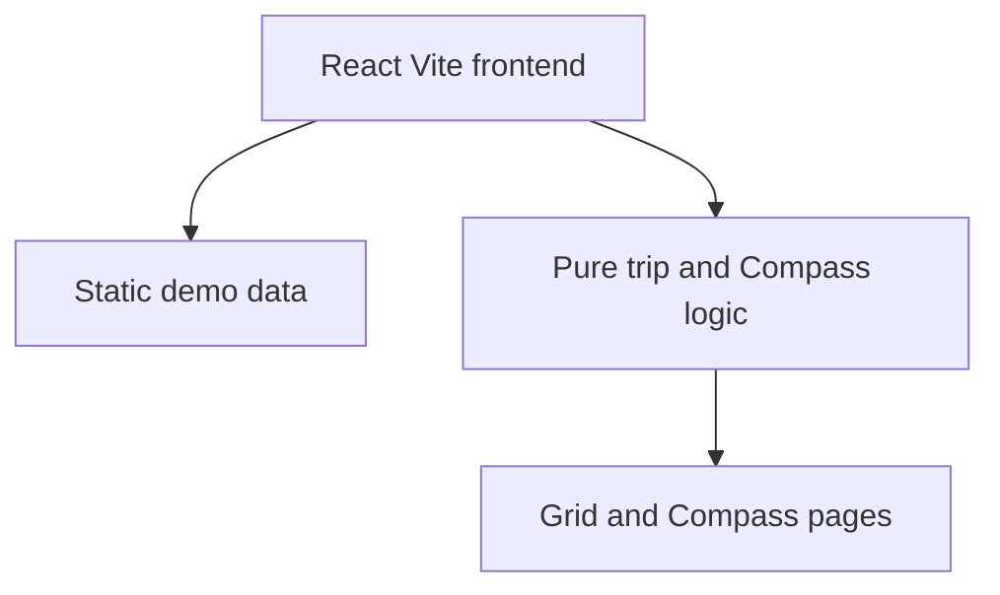

# Namma Flow Architecture

## Current MVP

Namma Flow is a static frontend application in `frontend/` built with React, Vite, and Tailwind CSS. It uses simulated zones, routes, and vibe suggestions stored in `frontend/src/data/`. Grid trip planning is implemented as pure frontend logic in `frontend/src/logic/tripLogic.js`.

There are no AWS services in use. The browser does not call Lambda, API Gateway, Bedrock, DynamoDB, or any other deployed backend. The former backend code is kept for reference under `experiments/backend-aws/` and is not part of the frontend build.

The map surface is isolated behind `frontend/src/components/maps/GridMap.jsx` and `CompassMap.jsx`, so map behavior remains separate from business rules.

## Runtime flow

## Environment

Copy `.env.example` to `frontend/.env.local` for Vite. Only `VITE_*` variables belong in this file; values are browser-visible and must not contain secrets.

## Archived backend

`experiments/backend-aws/` contains the retained AWS/Lambda experiments. It is intentionally parked and unused. See `docs/TEAM_CONTRACTS.md` for collaboration boundaries.
